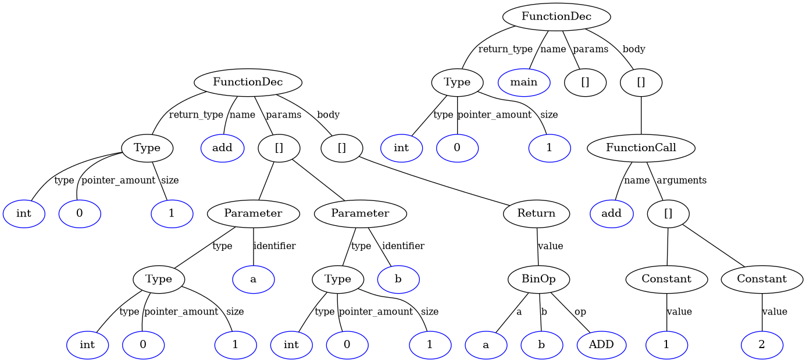
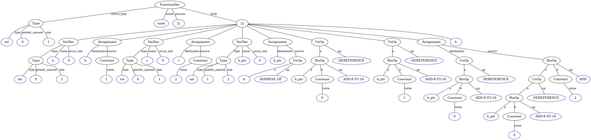

# The compiler

The compiler takes a subset of C to the stack machine language described in [The VM layer](vm-layer.md). It is three hand-written stages in `compiler/`: a lexer, a recursive-descent parser, and a code generator. There is no optimizer and no type checker beyond what code generation needs.

## Lexer

`compiler/lexer.py` strips comments with a shared regex helper (`helpers.py`), then walks the source one character at a time and produces `(value, type, line)` tuples. Token types are keyword, identifier, integerConstant, stringConstant, and symbol. The keyword list covers `int`, `char`, `bool`, `void`, `true`, `false`, `if`, `else`, `while`, `return`, and `struct`, though not everything the lexer accepts is implemented further down.

## Parser

`compiler/parser.py` is a straightforward recursive descent over the token stream, one method per construct: `parse_function_dec`, `parse_var_dec`, `parse_statements`, `parse_if`, `parse_while`, `parse_return`, `parse_function_call`, `parse_array_subscript`. Node classes live in `compiler/AST_types.py`.

Expressions are handled separately in `compiler/parse_expression.py` with a generated precedence climber. A table lists the operator tiers, and `generate_expression_parsers` builds one parsing function per tier, each calling the next tighter one. From loosest to tightest: `|`, `&`, `&&`, equality (`==`, `!=`), relational (`<`, `>`, `<=`, `>=`), shift (`<<`), additive (`+`, `-`), multiplicative (`*`, `/`). Unary operators (`-`, `~`, `!`, `*`, `&`) are handled in `parse_factor`.

Array subscripts are desugared during parsing. `arr[i]` becomes `*(arr ADD-16 i)`, a dereference of a 16-bit pointer sum, so the code generator never sees a subscript node.

## The AST, rendered

Every compile draws the syntax tree. `parser.parse()` calls `draw_ast` (`compiler/draw_ast.py`), which walks the node objects with `vars()` and renders them through Graphviz into `output.png`. This is the tree for `programs/example.c`, an `add` function and a `main` that calls it:

```c
int add(int a, int b) {
    return a + b;
}

int main()
{
    add(1, 2);
}
```



Blue ovals are leaf values, black ovals are node types, and edge labels are field names. The same renderer on a full test program produces trees like this one, from the test suite:



## Code generator

`compiler/code_generator.py` walks the AST and emits VM commands. It keeps one symbol table per function with local and argument variables, each entry carrying a name, a type, and a stack index. Sizes are 1 for scalars and 2 for pointers, so a pointer occupies two consecutive slots and `symbol_table_size` accounts for that when assigning indexes.

The interesting cases:

| Construct | Emitted VM code |
| --- | --- |
| constant | `push constant n` |
| variable read | `push local i` or `push argument i`, twice for pointers |
| binary operation | left operand, right operand, then the operator name |
| assignment to variable | expression, then `pop local i` per slot |
| assignment through `*p` | expression, pointer expression, then `poke` |
| `&x` | `push address-of-local i` |
| `if` / `else if` / `else` | conditions with `if-goto` into labeled bodies, `goto` past the rest |
| `while` | a start label, the condition, `if-not-goto` out, body, `goto` back |
| call | arguments, then `call name nargs` |
| function | `function name nlocals` header |

## What it does not support

There are no `for` loops, no structs (the keyword parses no further), no division or multiplication operators at run time (the `*` and `/` operators parse, but the VM layer has no lowering for them, so multiplication is written as C functions like `tests/recursive_mult.c`), no global variable initialization, no strings beyond lexing, no `char` semantics distinct from `int`, and no casts. Function arguments and locals are the only storage classes. The subset is small, and the 24 programs in `tests/` are an exact inventory of what works.

## Try it

Compile a single file to VM code only, and view the tree it drew:

```bash
python3 ./compiler/code_generator.py programs/example.c -o example.vm
cat example.vm        # the VM code
xdg-open output.png   # the AST it drew
```
