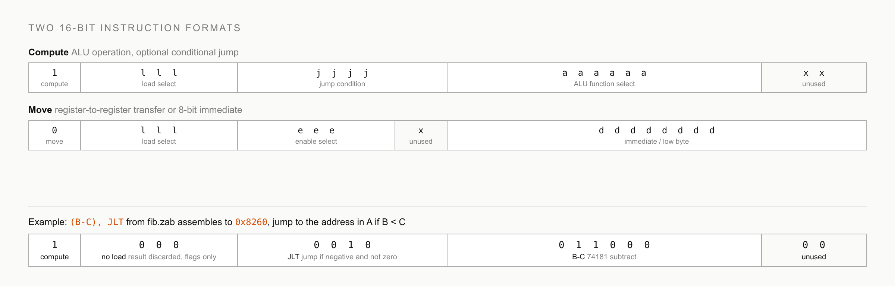

# CPU and instruction set

The CPU moves 8-bit data over a single bus and addresses 64KB of memory. Every instruction is 16 bits wide and comes in one of two formats, selected by the top bit of the low byte.

## Registers

| Register | Width | Role |
| --- | --- | --- |
| AHigh, ALow | 8 + 8 | The A register, the only way to address memory. Every RAM access reads or writes `*A` |
| B | 8 | First ALU operand |
| C | 8 | Second ALU operand |
| IRHigh, IRLow | 8 + 8 | Instruction register. IRHigh doubles as the source for 8-bit immediates |
| PC | 16 | Program counter |

The register set, the load and enable select codes, and the jump table are defined once in `constants.py` and mirrored in `emulator_core/constants.js`.

## The two formats



A move instruction (`0lll eeex dddd dddd`) selects one register to drive the bus (`e`, the enable field) and one register to load from it (`l`, the load field). When the enable field selects IRHigh, the top eight bits of the instruction itself become the value, which is how constants get into registers: `AHigh = 128` assembles to `0x1c 0x80`.

A compute instruction (`1lll jjjj aaaa aaxx`) runs the ALU over B and C. The `a` field feeds the 74181 function select lines directly (see [The ALU](alu.md)), the `l` field optionally loads the result into a register, and the `j` field names a jump condition checked against the ALU flags. A conditional jump therefore costs nothing extra. It rides along with any computation.

| Field code | Load targets | Enable sources |
| --- | --- | --- |
| 001 | AHigh | AHigh |
| 010 | ALow | ALow |
| 011 | B | B |
| 100 | C | C |
| 101 | RAM | RAM |
| 110 | | IRHigh |

## Jump conditions

Jumps go to the address currently in A. The condition is evaluated from the ALU's negative, zero, and carry flags, per `SHOULD_JUMP` in `constants.py`.

| Code | Mnemonic | Taken when |
| --- | --- | --- |
| 0001 | JLE | negative or zero |
| 0010 | JLT | negative and not zero |
| 0011 | JEQ | zero |
| 0100 | JGT | not negative and not zero |
| 0101 | JGE | not negative or zero |
| 0110 | JC | carry |
| 0111 | JNC | not carry |
| 1000 | JMP | always |
| 1001 | JNE | not zero |

## A worked encoding

The instruction `(B-C), JLT` from fib.zab computes B minus C, discards the result, and jumps if the difference is negative. Encoding it by hand:

```text
low byte    1 000 0010      compute, no load, jump = JLT
high byte   011000 00       ALU select for B-C, two unused bits
bytes       0x82 0x60
```

The assembler emits the low byte first, so the pair appears as `82 60` in a hex dump. Instructions occupy two bytes, which is why every jump target in the ROM listing of the emulator sits at an even address.

## Where the code lives

The encoding tables sit in `constants.py` (`LOADS`, `ENABLES`, `JUMP_NAMES`) and `assembler.py` (`EXPRESSIONS`). The authoritative notes for both formats are in `information/instruction_set _v2.txt`. Decoding for the emulators lives in `emulator_core/Computer.js` (`disassemble`, `processMoveInstruction`, `processComputationInstruction`).

## Try it

Assemble a single instruction and inspect the bytes:

```bash
echo "AHigh = 128" > one.zab
python3 assembler.py one.zab -o one.bin
xxd one.bin        # 1c80
```
