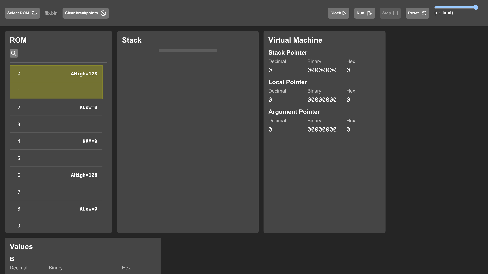
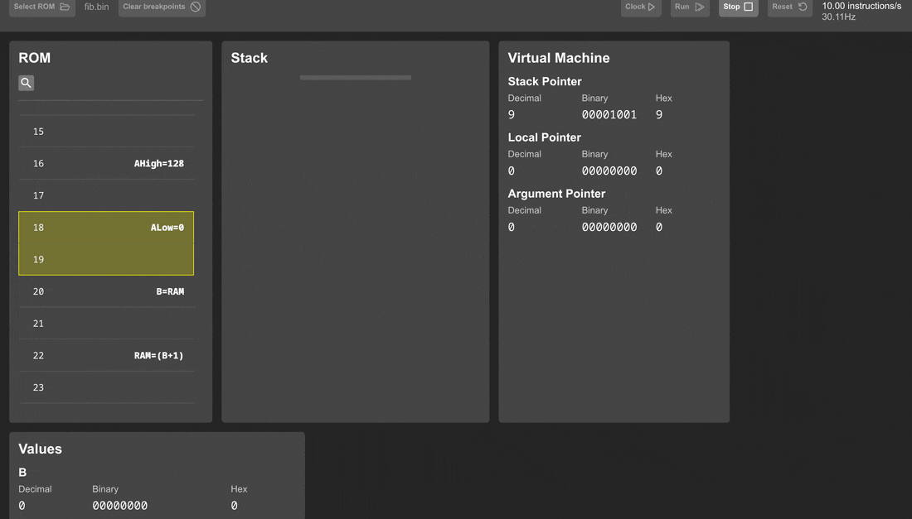
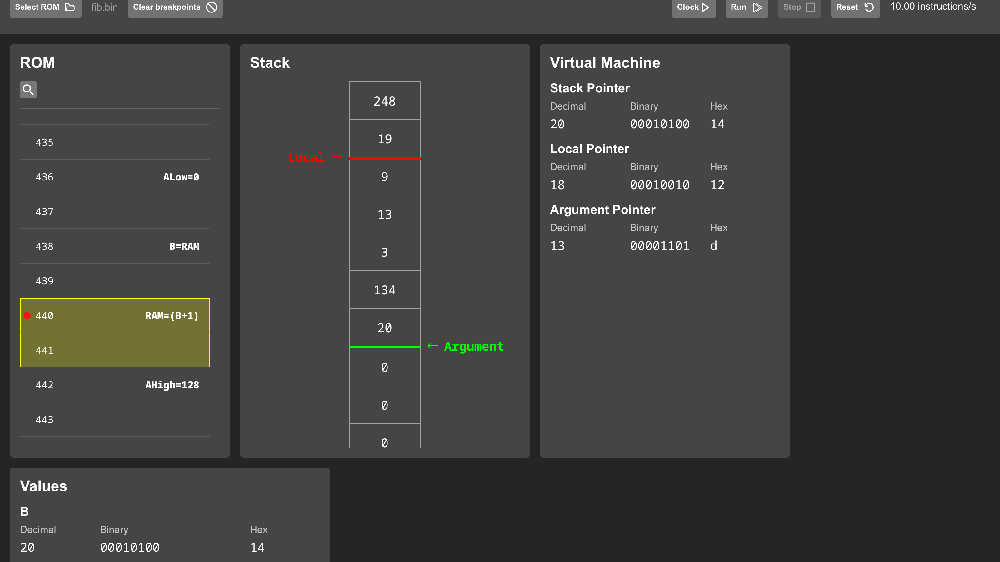
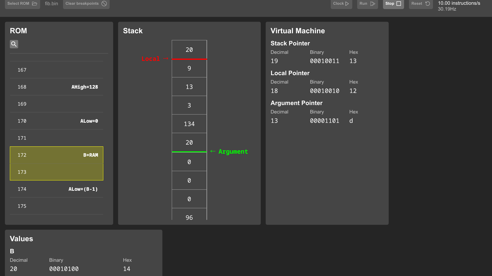

# The emulators

There are two emulators and one core. `emulator_core/` is a headless JavaScript model of the machine, and `emulator/` is a React app that wraps the same core in a debugger interface. The React app's `src/core` directory is a symlink to `emulator_core/`, so there is exactly one implementation of the machine's behavior.

## The headless core

`emulator_core/Computer.js` models the machine at the register level, stepped one instruction per `clock()` call:

1. `nextInstruction` reads two bytes at the program counter into IRLow and IRHigh and advances the counter by two.
2. The format bit of IRLow picks the path: `processMoveInstruction` or `processComputationInstruction`.
3. A move resolves the load and enable fields against the register file, with RAM accesses going through `readMemory` and `writeMemory` at the address in A. An enable of IRHigh yields the immediate byte.
4. A compute feeds B, C, and the six ALU bits to `ALUCircuit`, evaluates `SHOULD_JUMP` against the returned flags, loads the program counter from A on a taken jump, and stores the result if a load target was given.

The core is instruction-stepped. It does not model the three microcode steps of the hardware fetch cycle, and flags exist only inside a single `clock()` call, matching the hardware's combinational flags. The gate-accurate part is the ALU: `ALUCircuit.js` is the 74181 as boolean equations exported from the Logisim design, chained twice, so arithmetic and flag behavior match the circuit gate for gate (see [The ALU](alu.md)).

The core also carries the memory map constants, a `disassemble` method that turns byte pairs back into assembly for display, a `getStack` helper that reads the VM's stack region, and an optional randomized-RAM mode used by the test suite to catch code that relies on zeroed memory. The disassembler's expression table in `emulator_core/constants.js` covers the common ALU functions and shows raw bits for patterns it does not know.

## The React app



`emulator/src/Components/Emulator.js` is the shell. The pieces:

| Panel | Source | Shows |
| --- | --- | --- |
| ROM | `Components/ROM.js` | the loaded binary disassembled row by row, with the program counter highlighted and breakpoints on click |
| Stack | `Components/Stack.js` | the live stack region with arrows marking where LOCAL and ARGUMENT point |
| Virtual Machine | `Components/VirtualMachine.js` | the three pointer bytes at RAM 0 to 2, in decimal, binary, and hex |
| Values | `Components/Registers.js` | B, C, AHigh, ALow, the combined A, and the byte at `*A` |
| Controls | `Components/Controls.js` | ROM picker, clock, run, stop, reset, breakpoint clearing, speed slider |

The machine runs inside a Web Worker (`src/hooks/computerWorker.js`) so the interface stays responsive at full speed. A `SharedArrayBuffer` carries the stop flag and throttle value between threads, which requires cross-origin isolation, enabled by the headers in `emulator/craco.config.js`. The `useComputerWorker` hook (`src/hooks/useComputerWorker.js`) posts commands to the worker and rebuilds a `Computer` prototype around each state snapshot it receives.

The speed slider maps to a delay of (1 - speed) x 500ms per instruction, from two instructions per second up to uncapped. Uncapped, the worker clocks the core in a tight loop and reports its measured rate. On the machine used for these figures it holds close to 12MHz:


## Watching a program run

At 10 instructions per second, fib.bin's execution is legible. The ROM listing tracks the program counter, and the stack fills with arguments and return addresses as `fib` recurses:



A higher quality capture of the same run: [emulator-run.mp4](media/emulator-run.mp4).

Clicking any even ROM row toggles a breakpoint. The worker checks the set after every instruction and stops when the program counter lands on one:





## Running it yourself

```bash
cd emulator
npm install
npm start          # dev server on port 3000
```

Two setup notes for a fresh clone. The `emulator/src/core` symlink is stored with an absolute path and must be re-pointed at the repository's `emulator_core/` directory. And `emulator/package.json` pins `node-sass`, which does not build on current Node; replacing it with `"sass": "^1.69.0"` works without any other change.

Then load any `.bin` produced by the toolchain with the Select ROM button. `tests/*.bin` all work. The test suite (`tests/test.js`) drives the same headless core from Node without the UI (see [the test suite workflow](workflow-test-suite.md)).
