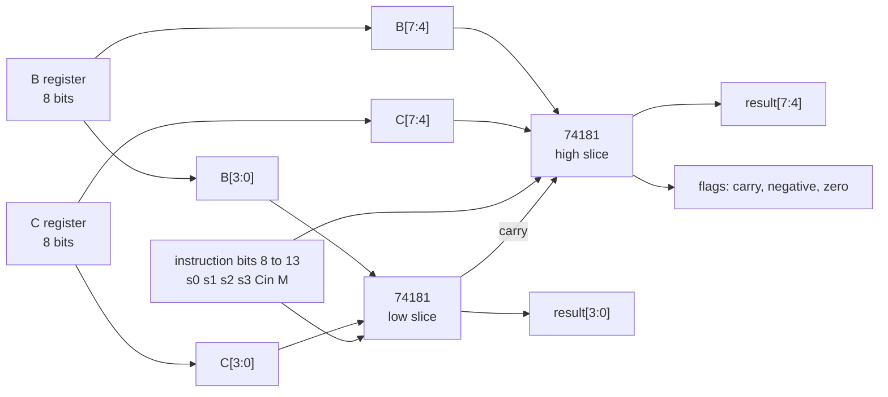

# The ALU

The arithmetic unit is built from the 74181, a 4-bit ALU chip from the 1960s that computes 16 arithmetic and 16 logic functions selected by four select lines and a mode line. This machine chains two of them into an 8-bit unit. The Logisim design instantiates two slices in its ALU circuit, and the emulator contains a gate-level model of the same chip.

## Two slices, one carry

The low slice takes bits 0 to 3 of B and C, the high slice takes bits 4 to 7. The carry out of the low slice feeds the carry in of the high slice. Flags come out of the high slice: carry out (inverted, since the 74181 carry is active low in this configuration), negative (bit 7 of the result), and zero (the whole byte equals zero).

This is exactly the structure of `ALUCircuit` in `emulator_core/ALUCircuit.js`: it calls a `TTL74181` function twice, patches the low slice's carry out into the high slice's control bits, and derives the three flags from the high slice. The `TTL74181` function itself is boolean logic exported from the Logisim design of the chip, so the emulator computes every result through the same gate equations the hardware would.

## The expression table

The six ALU bits in a compute instruction map straight onto the 74181 (4-bit ALU slice) control pins: four select lines, carry in, and mode. The assembler does not expose all 32 combinations. It has a fixed table of the useful ones, in `EXPRESSIONS` in `assembler.py`:

| Expression | s0 s1 s2 s3 C M |
| --- | --- |
| B+C | 100110 |
| B-C | 011000 |
| B-C-1 | 011010 |
| B+1 | 000000 |
| B-1 | 111110 |
| B+B | 110010 |
| B | 000010 |
| C | 101001 |
| B\|C | 111001 |
| B&C | 101101 |

Any of these can appear in parentheses in assembly, with an optional destination and an optional jump: `RAM = (B+C)`, `C = (B-1)`, `(B-C), JLT`. A naming trap to be aware of: the assembler comments note that the register the 74181 (4-bit ALU slice) datasheet calls A is wired to this machine's B register, and datasheet B is wired to register C.

## How flags feed jumps

The flags never persist in a register. They are combinational outputs of the ALU, valid while a compute instruction executes, and they feed two consumers:

1. In hardware, the three flag bits form part of the control store address, so the microcode word for a compute instruction already encodes whether the jump condition holds (see [Microcode and the control store](microcode-and-control-store.md)).
2. In the emulator, `processComputationInstruction` in `emulator_core/Computer.js` calls `SHOULD_JUMP` with the jump field and the flags from `ALUCircuit`, and loads the program counter from A when it returns true.

Because flags do not persist, a comparison and its jump must be a single instruction. This is why the VM translator emits sequences such as `(B-C), JEQ` with the target address parked in A beforehand (see [The VM layer](vm-layer.md)).

## Where the code lives

The gate-level chip model and the two-slice chaining are in `emulator_core/ALUCircuit.js`. The expression encodings are in `assembler.py` (`EXPRESSIONS`) with a display-side copy in `emulator_core/constants.js`. The Logisim schematic of the chip is the `fixed74181` circuit inside `pcb_computer.circ`.
