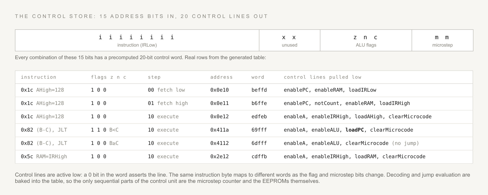
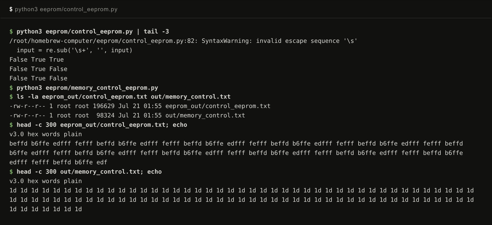

# Microcode and the control store

The control unit of this machine is a lookup table. Two Python scripts in `eeprom/` enumerate every possible input state and precompute the control word for each one. The resulting tables are burned onto AT28C256 EEPROMs (32K x 8, datasheet in `information/74878AT.pdf`). Changing the instruction set means regenerating two files, not rewiring anything.

## The CPU control store

`eeprom/control_eeprom.py` builds a table with 2^15 = 32768 entries. The 15 address bits are the machine's entire visible state:

The eight instruction bits are the low byte of the instruction register, which holds the format bit, the load field, and either the enable or the jump field. The three flag bits come from the ALU, with zero and carry wired in inverted form (the script reads them as `not zero` and `not carry`, per the comments at the top of `generate_controls`). The two microstep bits come from a small counter.

Each entry is a 20-bit word with one bit per control line, grouped in the script by the physical board the line belongs to: instruction register, A register, B register, C register, memory address source, program counter, RAM, and ALU. The lines are active low. `generate_bits` writes a 0 for every asserted line, which is why an idle line reads 1 and the raw table is mostly f digits.

## The three microsteps

Every instruction executes in three steps, selected by the microstep bits. The logic in `generate_controls` is short enough to summarize completely:

1. Step 00 fetches the low byte: RAM drives the bus at the program counter's address and IRLow loads.
2. Step 01 fetches the high byte into IRHigh and raises notCount, which the script's comment describes as fetching the high byte without incrementing the program counter.
3. Step 10 executes: the address bus switches from the program counter to the A register, clearMicrocode resets the step counter, and the instruction's own bits determine the rest. A move asserts one load and one enable line. A compute asserts enableALU, and asserts loadPC when `SHOULD_JUMP` says the jump condition holds for the current flags.

The jump decision is not circuitry. `control_eeprom.py` imports `SHOULD_JUMP` from `constants.py`, the same function the emulator calls at run time, and evaluates it at table generation time for every combination of jump field and flags. Row four and row five of the figure above show the result: the same instruction byte, `(B-C), JLT`, maps to a word with loadPC asserted when the negative flag is set and to a word without it when the flag is clear.

## The memory control store

`eeprom/memory_control_eeprom.py` builds the second table, also 2^15 entries. Its address bits are one selector bit plus the top 14 bits of the memory address, and its outputs are the chip enables that carve up the address space: chipEnableROM below 0x400, chipEnableVRAM from 0x1000 to 0x1FFF, enableIn at 0x400, loadOut at 0x401, and chipEnableRAM whenever the selector bit says the access is in RAM space. This table is the memory map (see [Memory system](memory-system.md)).

## Running the generators

Both scripts run from the repository root and write Logisim-format hex files. This is real output on a fresh clone:

The `False True True` lines are the script printing each flag decode as it evaluates jump conditions. Both regenerated tables are byte-identical to the committed copies in `eeprom_out/`. One path quirk: `control_eeprom.py` writes into `eeprom_out/`, while `memory_control_eeprom.py` writes into `out/`, so its output has to be copied into `eeprom_out/` by hand.

## Where the code lives

The generators are `eeprom/control_eeprom.py` and `eeprom/memory_control_eeprom.py`. The shared jump logic is `SHOULD_JUMP` in `constants.py`. The committed tables are in `eeprom_out/`, in the `v3.0 hex words plain` format that Logisim's ROM components load directly. `bootloader.txt` in the repository root is a small hand-assembled ROM image in the same format.
