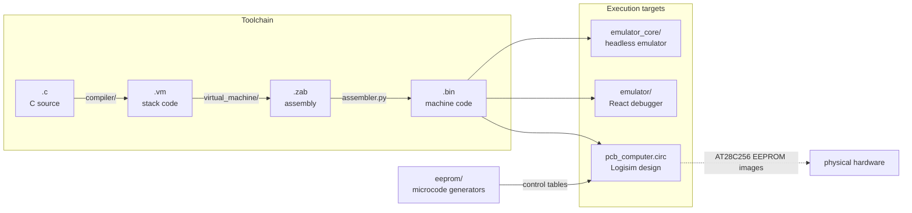

# Overview

This project is a complete computing platform built from scratch: an 8-bit CPU designed in Logisim Evolution around 7400-series TTL logic, and every layer of software needed to get a C program running on it. Nothing in the path is borrowed. The compiler, the intermediate language, the assembler, the instruction set, the microcode, and the emulators are all part of this repository.

## The whole stack

A program starts as C source and passes through three translators before it becomes machine code. The same binary then runs in three places: the headless emulator core, the React debugger app, and the Logisim circuit whose control signals come from generated EEPROM images.

One number makes the expansion concrete: `tests/fib.c` is a dozen lines of C, becomes 25 lines of stack code, then 545 lines of assembly, and assembles to 508 instructions in a 1016-byte binary.

## The memory map

The CPU addresses 64KB through a single 16-bit address register. The map is decoded by a dedicated EEPROM (see [Memory system](memory-system.md)).

| Range | Size | Region |
| --- | --- | --- |
| 0x0000 to 0x03FF | 1KB | ROM, where code executes |
| 0x0400 | 1 byte | IN port |
| 0x0401 | 1 byte | OUT port |
| 0x1000 to 0x1FFF | 4KB | VRAM, reserved for video output |
| 0x8000 to 0xFFFF | 32KB | RAM, stack and all program data |

The stack starts at RAM address 9 and the virtual machine keeps its pointer variables in the first six RAM bytes. These constants appear in `virtual_machine/virtual_machine.py` (`STACK_START = 9`) and `emulator_core/Computer.js` (the `START_*` and `*_SIZE` statics).

## Where everything lives

| Path | Contents |
| --- | --- |
| `compiler/` | C lexer, recursive-descent parser, code generator, AST renderer |
| `virtual_machine/` | The VM-to-assembly translator |
| `assembler.py`, `constants.py` | The two-pass assembler and the shared instruction tables |
| `compile.py` | One-shot driver that chains the three stages |
| `eeprom/` | Microcode table generators, output in `eeprom_out/` |
| `emulator_core/` | Headless JavaScript emulator with the gate-level 74181 model |
| `emulator/` | React debugger app built on the same core |
| `pcb_computer.circ` | The full Logisim Evolution design |
| `tests/` | 24 C programs with the binaries they should compile to |
| `programs/` | Hand-written assembly and example C programs |
| `information/` | Instruction set notes and chip datasheets |
| `i2c/` | Bit-banged I2C transmitter experiment |

## Reading order

Start with [CPU and instruction set](cpu-and-instruction-set.md) to learn the two instruction formats. [The ALU](alu.md) and [Microcode and the control store](microcode-and-control-store.md) explain how those instructions become control signals. Then follow a program down the stack: [The compiler](compiler.md), [The VM layer](vm-layer.md), [The assembler](assembler.md), [The emulators](emulators.md). The [end to end workflow](workflow-running-a-program.md) ties it together with real commands.
