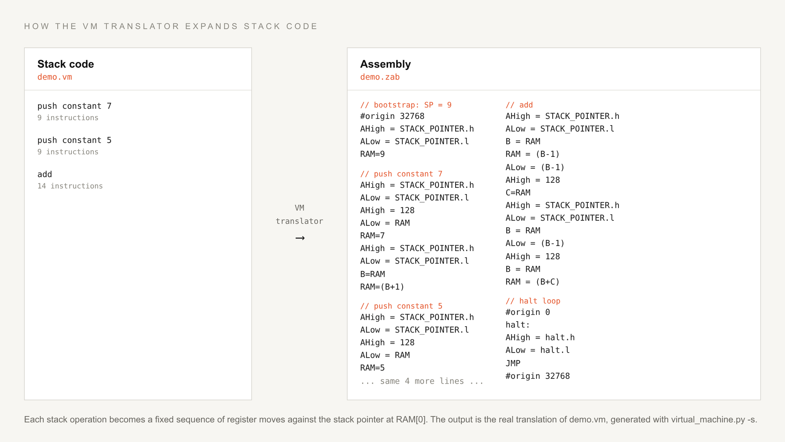
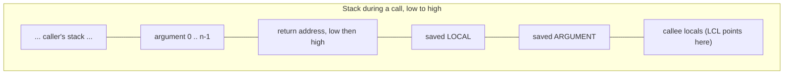

# The VM layer

Between C and assembly sits a stack machine, in the style of the nand2tetris VM. The compiler emits stack operations, and the translator in `virtual_machine/virtual_machine.py` expands each one into a fixed sequence of register moves. This split keeps the compiler simple. It never thinks about registers, only about pushes and pops.

## Machine state

The VM's entire state lives at fixed RAM addresses, established as assembler symbols in `assembler.py` and used by every generated sequence:

| Address (RAM) | Symbol | Holds |
| --- | --- | --- |
| 0 | STACK_POINTER | low byte of the next free stack slot |
| 1 | LOCAL | low byte of the current local segment base |
| 2 | ARGUMENT | low byte of the current argument segment base |
| 3 to 5 | TEMP_0 to TEMP_2 | scratch bytes for multi-step operations |

The stack itself starts at RAM address 9 (`STACK_START` in the translator) and stays within the first 256 bytes of RAM, so the high address byte is always 128 and only low bytes need arithmetic. `information/vm_instruction_set.txt` notes the consequence: the stack is capped at 256 entries.

## The command set

Parsing is a two-class affair, `Parser` and `CodeWriter`, in `virtual_machine/virtual_machine.py`:

| Group | Commands |
| --- | --- |
| stack | `push` / `pop` on segments constant, local, argument, pointer, address-of-local, address-of-argument |
| arithmetic | add, subtract, or, bitwise_and, left_shift, not, equal, inequal, greater_than, less_than, greater_than_or_equal, less_than_or_equal |
| pointers | dereference, poke, 8-to-16, add-16, sub-16 |
| control flow | label, goto, if-goto, if-not-goto |
| functions | function, call, return |

The five operations in `built_in_arithmetic` (add, subtract, or, bitwise_and, left_shift) map to single ALU expressions. The comparisons cannot, because the machine has no instruction that materializes a flag as a value, so each one expands into a compare, a conditional jump, and two labeled blocks that write 1 or 0 to the stack top.

## What expansion looks like

Every operation follows the same shape: point A at the stack pointer, load it, move A to the stack top, read or write, and adjust the pointer. Nothing is cached between operations, which is why the 25 lines of `fib.vm` become 545 lines of `fib.zab`.

## The calling convention

`call f n` and `return` are where the VM earns its keep. The expansion in `write_call` and `write_return` implements a full frame protocol:

On `call f n` the translator pushes a generated return label (two bytes), then the current LOCAL and ARGUMENT bytes, sets ARGUMENT to the stack pointer minus (n + 4), sets LOCAL to the stack pointer, and jumps to `f`. The matching `return` walks it back: it stashes the frame base, recovers the return address into TEMP_0 and TEMP_1, writes the return value over argument 0, cuts the stack back to ARGUMENT plus 1, restores the saved segment bytes, and jumps through the recovered address. Recursion works because every call gets a fresh frame and a unique return label (`RETURNmain0`, `RETURNfib1`, and so on, numbered by a translator counter).

The translator also plants a bootstrap at the start of every program: set the stack pointer to 9, then `call main 0`. A `-s` flag skips the call for standalone snippets, and a `-r` flag emits code positioned to run from RAM instead of ROM.

## Labels and the two address bases

Code labels must resolve to ROM addresses, but the translated code itself is data-addressed from 0x8000 when computing stack values. The translator wraps every label definition in `#origin 0` and `#origin 32768` pairs so the assembler assigns ROM addresses to jump targets while keeping data symbols in RAM space. The mechanics are on the [assembler page](assembler.md).

## Where the code lives

Everything is in `virtual_machine/virtual_machine.py`: `Parser` at the top, `CodeWriter` below it, with one `write_*` method per command family. The command list documentation is `information/vm_instruction_set.txt`, and hand-written VM programs to study are `programs/fib.vm`, `programs/stack_test.vm`, and `programs/add-8-to-16.vm`.
