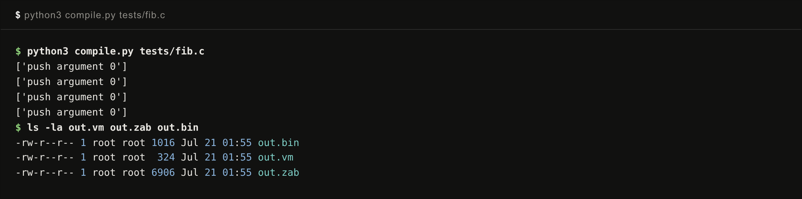
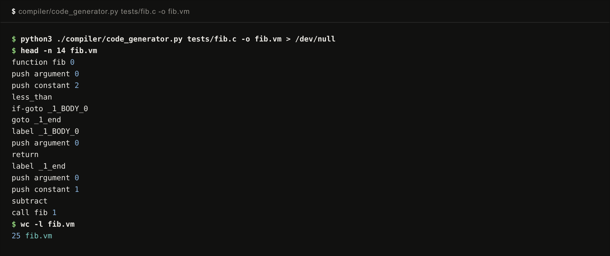
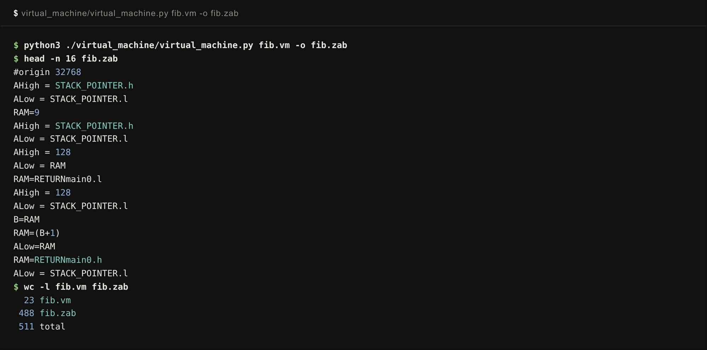

# Workflow: running a program end to end

This page follows one program, `tests/fib.c`, from C source to execution in the emulator. Every command runs from the repository root, and every figure is the real output of that command. The program is recursive Fibonacci:

```c
int fib(int n)
{
    if (n < 2)
    {
        return n;
    }
    return fib(n - 1) + fib(n - 2);
}
int main()
{
    fib(8);
    fib(5);
}
```

## The short way

`compile.py` chains all three stages and writes `out.vm`, `out.zab`, and `out.bin` next to each other:



The `['push argument 0']` lines are debug prints from the code generator. The result is a 1016-byte binary, 508 instructions. The rest of this page runs the same pipeline one stage at a time.

## Stage 1: C to stack code



`compiler/code_generator.py` emits one `.vm` line per stack operation. The whole program is 25 lines. This stage also draws the AST to `output.png` as a side effect (see [The compiler](compiler.md)).

## Stage 2: stack code to assembly



`virtual_machine/virtual_machine.py` expands each stack operation into register moves, 545 lines in total. The head of the file shows the bootstrap (stack pointer to 9, then the expansion of `call main 0`) described in [The VM layer](vm-layer.md).

## Stage 3: assembly to machine code


`assembler.py` resolves the labels in two passes and emits instruction pairs, low byte first. The first word, `1c80`, is `AHigh = 128`, the start of the bootstrap.

## Run it

Start the emulator (see [The emulators](emulators.md) for one-time setup):

```bash
cd emulator && npm start
```

Load `fib.bin` with the Select ROM button, drag the speed slider down to a few instructions per second, and press Run:


The highlight walks the bootstrap, jumps into `main`, and the stack grows and shrinks through the recursion, with the argument and local pointers tracking each frame. The same binary can also run headlessly:

```bash
node -e "
const Computer = require('./emulator_core/Computer');
const c = new Computer();
c.loadROM(require('fs').readFileSync('out.bin'));
c.clock(200000);
console.log(c.getStack());
"
```

## The commands, in one place

```bash
python3 compile.py tests/fib.c                                   # all three stages
python3 ./compiler/code_generator.py tests/fib.c -o fib.vm       # stage 1
python3 ./virtual_machine/virtual_machine.py fib.vm -o fib.zab   # stage 2
python3 ./assembler.py fib.zab -o fib.bin                        # stage 3
```
