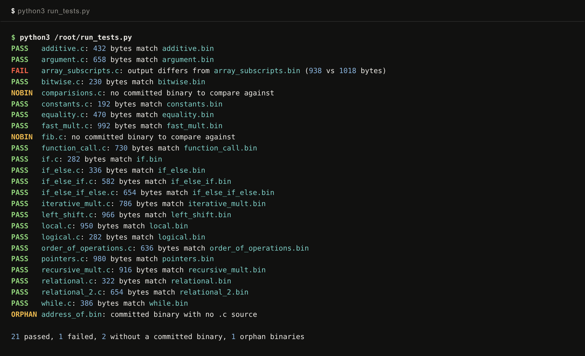
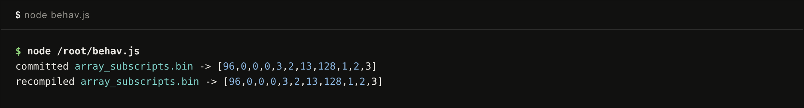

# Workflow: the test suite

`tests/` contains 24 C programs, most of them paired with the binary they should compile to. Each program exercises one feature: a test per operator family, control flow shapes from plain `if` to `if` / `else if` / `else`, locals, arguments, function calls, pointers, array subscripts, and three multiplication algorithms written in C because the machine has no multiply instruction.

There are two ways to check the suite: recompile everything and diff against the committed binaries, or run the behavioral Jest suite that executes each program in the headless emulator.

## Recompiling against the committed binaries

A short throwaway runner compiles every `tests/*.c` with `compile.py` and byte-compares the output with the committed `.bin`. These are the results on a fresh clone:



The honest summary: 21 of 22 comparable programs produce byte-identical binaries. The exceptions:

1. `array_subscripts.c` compiles to 938 bytes against a committed 1018-byte binary. The compiler has changed since that binary was committed.
2. `comparisions.c` and `fib.c` have no committed binary to compare against.
3. `address_of.bin` is a committed binary whose source file is not in the repository.

## Is the one mismatch a regression?

A byte diff cannot tell a regression from a compiler improvement, so the next check loads both binaries into the headless core (`emulator_core/Computer.js`), runs 200000 clocks, and compares the final stacks:



Both binaries leave the identical stack, ending in the `[1, 2, 3]` the Jest suite expects. The committed binary is stale, and the current compiler produces a smaller program with the same behavior.

## The behavioral suite

`tests/test.js` is the suite the repository actually ships. For each program it compiles from source, loads the result into a fresh `Computer`, clocks it 200000 times, and asserts on the final stack contents:

```js
test("recursive multiplication", () => {
  testStack("recursive_mult.c", [30]);
});
```

A `RANDOMIZE` flag at the top switches the core to random initial RAM, which catches programs that silently rely on zeroed memory. The suite needs a Jest setup to run; the recompile-and-diff runner above needs only Python and covers the toolchain half of the same ground.

## Reading the tests as documentation

The suite doubles as the specification of the C subset. If a construct appears in `tests/`, it works, and the expected stack in `tests/test.js` states exactly what it does. `tests/pointers.c` is the best single file to read: it covers address-of, dereference, pointer arguments, and write-through in 14 lines.
