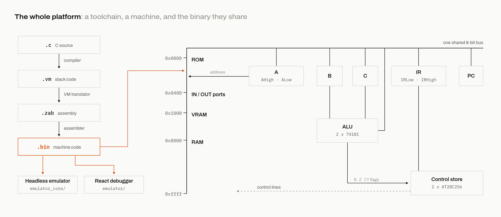
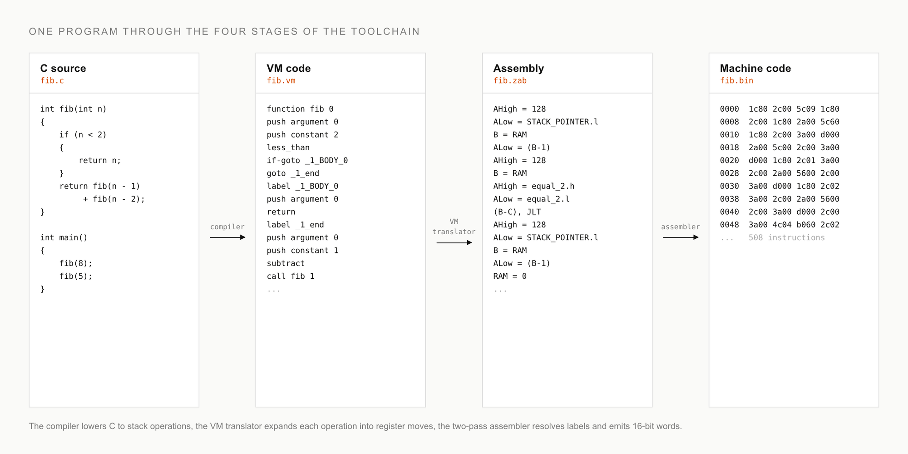

# Why I built this

I wanted to know how computers actually work. Not the version with the train analogy for the bus, and not the version that ends with "and then the transistors do the rest". Every explanation I found stopped at one of two depths. Either it was so abstract that nothing stuck, or it went deep on one layer and left an enormous gap between that layer and the thing on my desk. Somewhere at the bottom of every computer there is a rock that we taught to think, and I could not find an explanation that walked all the way down to the rock without skipping steps.

So I decided to build the whole path myself. The goal, from the start, was a real physical computer that I could assemble with my own hands out of 1960s logic chips, running a language I actually use. Not a kit, not a followed tutorial, my own machine with my own instruction set. If I could take a subset of C, compile it with my own compiler, assemble it with my own assembler, and watch my own hardware design execute it, then I would let myself say I understood the platform end to end.

Two projects got me partway there before this one existed, and I recommend both. [nand2tetris](https://www.nand2tetris.org/) walks you from NAND gates to Tetris, and its software stack shaped mine. But it lives entirely in simulation, and I wanted an artifact. [Ben Eater's breadboard computer videos](https://eater.net/) are the opposite: real chips, real wires, real blinking LEDs. But his machine is deliberately minimal, and the hard wall is addressing: its instruction format cannot reach enough memory to hold a real program, so no real programming language could ever target it. I wanted the intersection: hardware you could physically build, running C. The other two influences are on the software side: [Crafting Interpreters](https://craftinginterpreters.com/), whose fingerprints are all over my parser, and Cornell's [CS 6120](https://www.cs.cornell.edu/courses/cs6120/2020fa/self-guided/) compilers course, which I worked through self-guided.

## Why it is the way it is

The machine is designed in Logisim Evolution at the level of individual purchasable chips, its control tables are generated and committed ready for real EEPROMs, and the binaries the toolchain produces run in two emulators and in the Logisim circuit. Behind all of it sits one question that I asked of every architectural choice: how hard would this be to physically wire on breadboards from 7400-series parts? Conceiving a circuit is cheap; wires are expensive. You will see that question decide things over and over in the chapters ahead, and it explains nearly every choice that looks strange at first glance.

## The tour

Here is the whole project in one paragraph, so you know where we are going. A C file passes through three translators. The compiler turns C into code for a small stack machine. A translator expands each stack operation into a fixed sequence of register moves. A two-pass assembler turns those into 16-bit instructions, two bytes each. The result runs on an 8-bit CPU with 16-bit addressing, six register bytes on one shared bus, an ALU made of two 74181 (4-bit ALU slice) chips, and a control unit that contains no logic at all, just lookup tables burned into EEPROMs. `tests/fib.c`, a recursive Fibonacci in a dozen lines, becomes 25 lines of stack code, then 545 lines of assembly, then a 1016-byte binary. That binary runs in a headless JavaScript emulator, in a React debugger app, and in the Logisim design itself.

Here is the debugger running that exact binary. The left panel is the ROM, disassembled, with the current instruction highlighted. The stack in the middle grows and shrinks as `fib` calls itself:

## How to read this

The chapters go bottom up through the hardware, then bottom up again through the software, and each one ends where the next begins. Chapters 2 through 8 are the machine: the chips, the shape, the registers, the addressing, the ALU, the microcode, the memory. Chapters 9 through 12 are the toolchain: parsing, code generation, the algorithms that fill in for missing instructions, and assembly. Chapters 13 and 14 run everything, and chapter 15 is a guided tour of the machine's weirdest corners. If you want a lookup table instead of a story, the [reference](../reference/index.md) covers the same material one page per subsystem.

Next: [What a 7400 chip actually is](02-what-a-7400-chip-actually-is.md)
