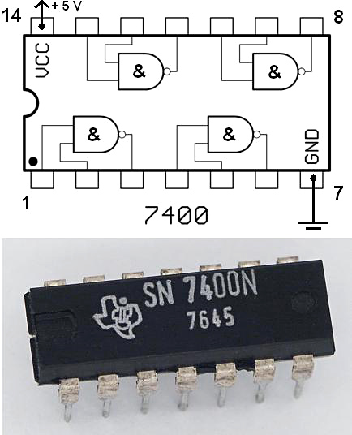
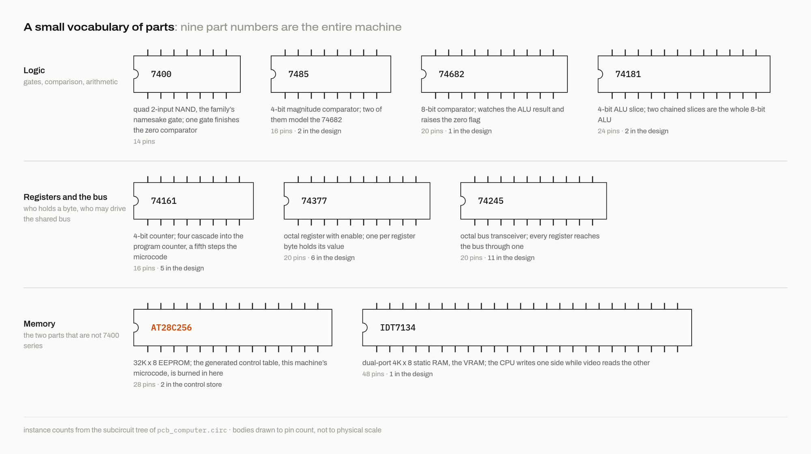

# What a 7400 chip actually is

Before we get to the machine, it helps to be clear about what it is made of. If you have never held one, the word "chip" probably brings to mind something like a CPU, a black square with a billion transistors inside doing work that nobody fully understands. A 7400-series part is almost the opposite: a small black rectangle with fourteen to twenty-four metal legs, running on five volts, that mostly does one small job. They look like caterpillars. That gap, a handful of transistors you can account for against the billion you take on faith, is the whole reason a person can build a computer this way and understand every part of it.

## A family of small, honest parts

These chips date to the 1960s. The original 7400 the series is numbered after is four NAND gates and nothing else: sixteen transistors on the die, and a datasheet you can read end to end in a few minutes. There is no firmware and nothing to configure, and the logic is plain enough that someone with no engineering background could follow everything the chip does in that same sitting.

The numbering counts roughly upward from there: 7404 is six inverters, 7474 is two flip-flops, 74161 is a 4-bit counter. The parts I lean on sit higher up the catalog, where one chip does register-sized or ALU-sized work, but the same rules hold all the way up. That is why every control signal here ends at a pin I can point to, and when I say later that a control line enables a register, I mean a wire touching the leg of a chip.

## The parts that do the work

Five parts do almost all the work in this machine:

| Part | What it is | Job in this machine |
| --- | --- | --- |
| 74377 | eight flip-flops with a shared clock enable | one of these stores one register byte |
| 74245 | eight-line bus transceiver | the valve that connects a register to the shared bus |
| 74161 | 4-bit binary counter | four of them chained form the program counter, one more runs the microcode step |
| 74181 | 4-bit ALU slice | two of them chained form the whole ALU |
| 74682 | 8-bit comparator | detects when the ALU result is zero |

The 74181 does the most, and it gets its own chapter later. It is a complete 4-bit arithmetic and logic unit in a single package, from a time when a CPU filled a cabinet and this chip was one slice of its math section. The 74245 is worth pausing on now, because it turns up on nearly every page from here on. Think of it as eight switches in a row. When its enable pin is held low the eight signals pass straight through, and when the pin goes high the chip electrically disappears from the bus. That second state is what lets a dozen registers share one set of wires without all of them talking over each other.

Three memory parts fill out the machine. The 62256 holds 32KB of static RAM, the IDT7134 is a stranger 4KB dual-port RAM that I come back to in chapter 8, and the AT28C256 is a 32KB EEPROM, a memory you program once and then read from forever. That last one is worth keeping in mind. In chapter 7 the EEPROM stops being a memory chip at all and becomes the part that decides what the machine does next.

On paper these parts are easy to like, and as objects to reason about they really are simple. Building with them in the physical world is harder, once you account for what they cost, how long they take to arrive, and what it means to wire hundreds of them by hand. I get to that in chapter 7, where it ends up forcing the oddest decision in the whole design. For now, the shape all these parts add up to.

Next: [The shape of the machine](03-the-shape-of-the-machine.md)
