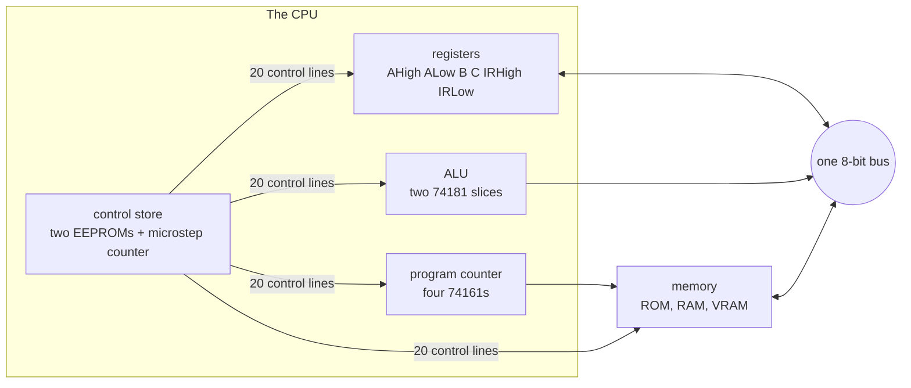

# The shape of the machine

Every design decision in this machine came out of the same weighing scale. On one side: what the feature buys. On the other: how many physical wires it costs on a breadboard. That scale has a sharp consequence. Anything that is easy to draw in a schematic but miserable to wire is a bad feature, no matter how elegant it looks on paper. The machine you are about to meet is the bare minimum computer that can run a subset of C, and I mean bare minimum as a design target I aimed at, never as an apology.

## What the minimum turned out to be

Here are the numbers that define the machine, all of which get their own chapters:

- 8-bit data. Every register, every bus transfer, every ALU operation is one byte.
- 16-bit addresses, because real programs do not fit in 256 bytes. Chapter 5 is about the gap between those two widths.
- One shared bus. Six register bytes hang off it: two halves of A, two halves of the instruction register, and the ALU operands B and C.
- Two instruction formats, move and compute. There is no third.
- An ALU with ten usable expressions, provided almost entirely by one chip design from the 1960s.
- A control unit with no logic gates in it at all. Two EEPROMs and a 2-bit counter run the whole machine.

Just as telling is the list of things the machine does not have. No interrupts. No DMA. No multiply or divide instruction. No stack pointer in hardware, no index registers, no carry-in to help with multi-byte math beyond a flag and a jump. Each of those would have earned its keep in a machine built for speed. None of them earned the wires.

## Harvard, for simplicity

One early fork in the road: von Neumann or Harvard? In a von Neumann machine, code and data live in the same memory, which is how every machine you use daily works. In a Harvard machine, the program has its own memory, separate from the data. I chose Harvard, and the reason was simplicity, nothing deeper. Code lives in a 1KB ROM chip that the machine physically cannot write, and data lives in a separate RAM chip. The program counter fetches from ROM, the program's pointers point at RAM, and neither can corrupt the other. Self-modifying code is off the table, and a whole class of wiring and sequencing questions disappears with it.

Both memories do share one 16-bit address map, which chapter 8 lays out. So the separation here is physical chips and write paths, and the address space is a single map with ROM at the bottom and RAM at the top. You could call it Harvard with one phone book.

## The principle, stated once

Let me make the weighing scale concrete, because it explains the strangest choice in the machine before you even meet it. Building a control unit the classical way means designing a web of logic gates that decode each instruction into control signals. Conceptually that is fine. Physically, on breadboards, it is hundreds of chips' worth of hand-routed wires, and every instruction set change means redoing some of them. Programming an EEPROM, by contrast, is something a cheap programmer does in seconds, and the chip drops into a socket. It is the closest thing a hobbyist has to fabricating a custom chip: describe any function of 15 inputs in a file, burn it, and the function exists as hardware.

So wherever this machine needs combinational logic in bulk, you will find an EEPROM where a textbook would draw gates. The control unit is an EEPROM. The memory address decoder is an EEPROM. This is slower than gates, and it is gloriously wasteful of memory, and I did not care about either cost, because the goal was a computer that works, never a computer that is fast.

Hold onto that principle. Chapters 4 through 8 walk the machine part by part, and the answer to "why is it like this?" is the same scale, weighed again and again.

Next: [Registers and the bus](04-registers-and-the-bus.md)
