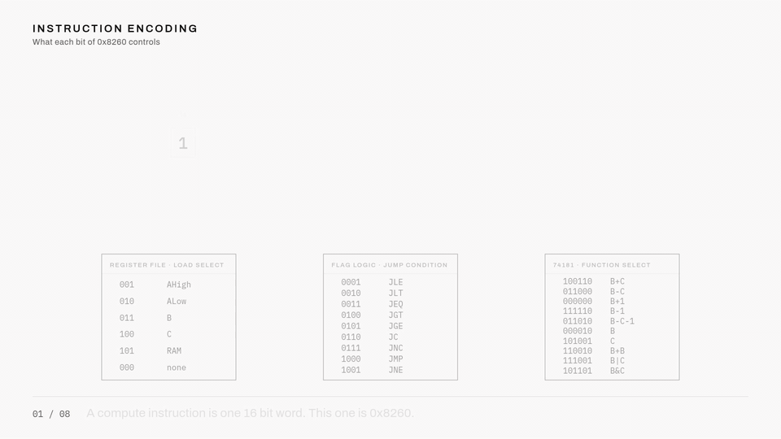

# Registers and the bus

If you have seen the programming model of a modern CPU, you might expect a machine to have a generous register file and instructions like "add r3 to r7 and put the result in r1". Every register in that sentence needs its own wiring into the ALU, and the instruction needs bits to name all three. Wires and bits are exactly what this machine is stingy with, so it does something much simpler. Everything, and I mean everything, moves through one 8-bit bus, one byte at a time.

## The cast

Six register bytes hang off the bus:

| Register | Role |
| --- | --- |
| AHigh, ALow | together the A register, the machine's one and only pointer |
| B | first ALU operand |
| C | second ALU operand |
| IRHigh, IRLow | the instruction register, holding the current instruction's two bytes |

Physically, each of these is a 74377 (octal register), the eight flip-flops from chapter 2, paired with a 74245 (bus transceiver). The transceiver is the register's mouth: when its enable line goes low, the register's value drives the bus. The flip-flops' clock enable is the register's ear: when its load line goes low, the register captures whatever is on the bus at the next clock. The program counter sits off to the side as a 16-bit chain of four 74161 (4-bit counter) chips, feeding the memory system rather than the bus.

That gives a delightfully simple picture of what the machine can do at all. At any moment, exactly one thing talks on the bus, and at most one register listens. Every register-to-register transfer in the machine is those two choices and nothing more: who talks, who listens.

## The move instruction is just that picture

Every instruction is 16 bits, fetched as two bytes. The first format, the move, encodes the picture directly:

```text
0lll eeex dddd dddd
```

The `e` field picks who talks. The `l` field picks who listens. The leading 0 says "this is a move". That is the whole instruction. `B = RAM` means the RAM talks and B listens. `ALow = B` means B talks and ALow listens.


Now, you may have noticed that eight of the sixteen bits, the `d` field, went unmentioned. Here is my favorite small trick in the instruction set. How do you get a constant into a register? A classical design adds a load-immediate instruction with its own format and its own decode path. This machine instead lets the enable field select IRHigh, the high byte of the instruction register, as the thing that talks. But the high byte of the instruction register is the top eight bits of the instruction currently executing. So `AHigh = 128` assembles to a perfectly ordinary move, with the value 128 parked in the instruction's own high byte, and the instruction hands itself the constant. No new format, no new wires. Immediates are free riders on the move.

Watch the whole thing happen one field at a time:



A click-through version of this animation is at [the explainers site](https://maxzabarka.github.io/homebrew-computer-explainers/#instruction-encoding); the source is on [GitHub](https://github.com/MaxZabarka/homebrew-computer-explainers).

## The compute instruction

The second format starts with a 1 and runs the ALU:

```text
1lll jjjj aaaa aaxx
```

The `a` field is six bits that go straight to the ALU chip's control pins, with no decoding in between, which is a story for chapter 6. The `l` field optionally stores the result, using the same listener codes as the move. And the `j` field names a jump condition that gets checked on every single compute instruction, which sounds expensive and turns out to be completely free. That trick needs the control store to explain, so I owe you two stories.

The full field tables, listener and talker codes, and a worked encoding are in the [CPU and instruction set reference](../reference/cpu-and-instruction-set.md).

## What this stinginess costs

The one-bus design means the machine cannot do anything in parallel. Moving a 16-bit value is two instructions. Loading two ALU operands is two instructions. Every interesting operation becomes a little parade of byte moves, and when you watch generated code run in chapter 14's debugger, you will see the parade clearly. I paid that cost knowingly: every additional bus would have been another sixteen-plus wires to every register that touches it, and the parade only costs time, which I had budgeted to spend.

There is one place where the stinginess bites harder than anywhere else: addresses. The bus moves 8 bits, and an address needs 16. That collision shaped the machine more than any other single thing, and it gets the next chapter to itself.

Next: [Two loads, one pointer](05-two-loads-one-pointer.md)
