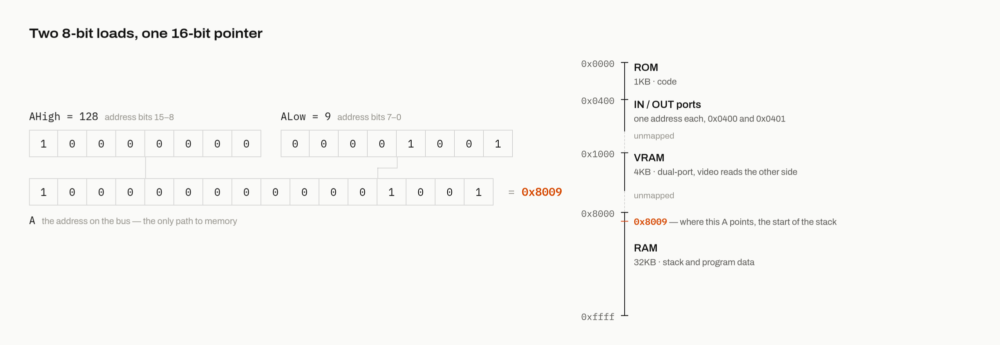

# Two loads, one pointer

Here is the trap that catches most minimal 8-bit designs, and it is the same trap I said Ben Eater's machine falls into. If your instructions and registers are 8 bits, the natural address size is also 8 bits, and 8 bits of address reaches 256 bytes of memory. Try to fit a compiler's output in 256 bytes. Try to fit a call stack. You cannot, and no real language can target such a machine. I wanted to run real software, so the address had to be wider than the data. This machine addresses 64KB with 16-bit addresses while moving data 8 bits at a time, and this chapter is about the seam where those two widths meet.

## The A register

A 16-bit address cannot cross an 8-bit bus in one move. It has to cross in two. So the machine's pointer, the A register, is physically two 8-bit registers, AHigh and ALow, sitting side by side on the address lines. Load each half with an ordinary move, and together they form one 16-bit address:

```text
AHigh = 128
ALow = 9
```

After those two instructions, A holds 0x8009, and the machine is pointing at RAM byte 9.



## One pointer for everything

Now the part that genuinely surprises people. You might expect several address registers, or at least separate ones for data and jumps. There is exactly one. Every RAM read is "the byte A points at". Every RAM write is "the byte A points at". And every jump, conditional or not, means "load the program counter from A". The machine has two possible address sources, the program counter for fetching instructions and A for absolutely everything else, and a four-chip selector picks between them.

Why so few? Count wires. An address register is 16 signals into the address selector, and every additional source widens that selector and its control. One pointer costs one selector input. On the weighing scale from chapter 3, a second pointer register buys convenience and costs a ribbon of physical wiring, and convenience lost.

## What it costs

The single split pointer taxes every layer above it, and I want to be honest about the size of the tax:

- Pointing anywhere costs up to two moves before the actual access happens.
- A branch is a small ritual: load AHigh with the target's high byte, load ALow with the low byte, then execute the instruction that jumps. Three instructions for one goto.
- Incrementing a 16-bit pointer is real work, because the ALU is 8 bits wide. Chapter 11 shows the carry dance that makes it correct.
- Since jumps and data access share A, code that is comparing values and branching is constantly reloading the same register for two different purposes.

## How the software fights back

The toolchain's main defense is to make the high byte boring. RAM starts at address 0x8000, and the virtual machine (chapter 10) keeps its entire stack inside the first 256 bytes of RAM. So the high byte of every stack address is always 128. Generated stack code sets `AHigh = 128` and then does all its real thinking in the low byte, where 8-bit arithmetic is enough. One page of RAM, addresses 0x8000 through 0x80FF, becomes the arena where almost the whole program lives.

The price of that defense is printed on the machine's spec sheet: the stack is capped at 256 entries. For the programs this machine runs, it is plenty, and it converts thousands of would-be 16-bit additions into 8-bit ones.

You can watch the whole system in miniature in the debugger. Here it is a few steps into the bootstrap of a compiled program, having just executed `AHigh=128`, `ALow=0`, and `RAM=9`. Those three instructions pointed A at RAM byte 0 and wrote 9 into it. That byte is the stack pointer, and 9 is where the stack begins:


Two moves, one pointer, everything through A. Keep that rhythm in mind. The next chapter covers the part of the machine that does the actual arithmetic, and it is the one major component I did not design, because the 1960s already had.

Next: [The ALU](06-the-alu.md)
