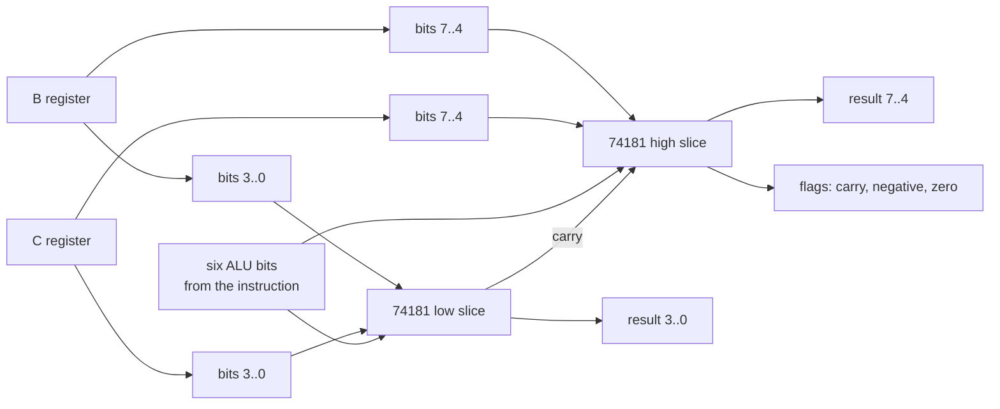

# The ALU

If you follow the nand2tetris path, you build your ALU out of gates you made yourself, and it is one of the best exercises in the book. I took the other road. The 74181 is a complete 4-bit ALU in a single 24-pin package, designed in the late 1960s, and it was the arithmetic heart of real minicomputers of that era. Two of them, chained, are the entire math department of this machine. Designing your own ALU is a fine afternoon of thinking. Wiring one from individual gate chips is weeks of breadboard work, and chapter 3 already told you how that scale weighs. The 74181 collapses all of it into two sockets.

## What the chip does

The 74181 computes 16 arithmetic functions and 16 logic functions over two 4-bit inputs. Which function you get is selected by six pins: four select lines, a mode line (arithmetic or logic), and a carry-in. Feed it different pin patterns and the same silicon adds, subtracts, ORs, ANDs, passes a value through, or does one of a dozen stranger things the designers threw in.

Remember the compute instruction format from chapter 4, with its six-bit `a` field? Those six bits are wired directly to these six pins. There is no decoding layer that translates "add" into pin settings. The instruction set simply is the chip's function table, exposed raw. The assembler puts a friendlier face on it with a fixed menu of ten expressions:

| Expression | What it computes |
| --- | --- |
| B+C | add |
| B-C | subtract |
| B-C-1 | subtract with borrow |
| B+1, B-1 | increment, decrement |
| B+B | double, which is also shift left |
| B, C | pass through |
| B\|C, B&C | bitwise or, and |

Any of these can appear in assembly inside parentheses: `RAM = (B+C)`, `C = (B-1)`, or bare as `(B-C)` when only the side effects matter. Which side effects? Hold that thought for one section.

One warning for anyone reading the schematics against the datasheet: the input the 74181 datasheet calls A is wired to this machine's B register, and the datasheet's B is wired to register C. The assembler comments warn about the same trap.

## Two slices, one carry

Four bits is half a byte, so the machine chains two slices. The low chip takes bits 0 to 3 of B and C, the high chip takes bits 4 to 7, and the low chip's carry-out feeds the high chip's carry-in, exactly like carrying a one in column addition.

Three flags come out of the top: carry (from the high slice, inverted, because the 74181's carry is active low in this configuration), negative (bit 7 of the result), and zero (a 74682, the 8-bit comparator, watching for an all-zero byte).

## The flags evaporate

Here is the property that shapes everything downstream, and it is easy to miss. In most CPUs, flags land in a status register and stay there, so you can compare now and branch three instructions later. This machine has no status register. The flags are combinational outputs, live wires that are only valid while the compute instruction is executing, and they vanish when it ends.

That sounds like a defect. A status register is more wiring and more state, and it turns out the machine never needs one, because of where the flags go: they feed the jump logic during the same instruction. A comparison and its branch are always one unit, `(B-C), JLT`, subtract and jump if negative, in a single instruction. The next chapter shows the machinery that makes the jump decision, and the trick is that there is no machinery.

## What the chip will not do

Look back at that expression menu and notice what is missing. No multiply. No divide. No right shift. The 74181 does not do any of them, so this machine does not have them, and I never considered adding hardware for them. When a C program on this machine multiplies two numbers, software does it with the operations on the menu, and it does it with some genuinely fun algorithms. That story gets its own chapter, number 11.

The gate-level details, including how the emulator runs the chip's actual boolean equations, are in [the ALU reference](../reference/alu.md).

Next: [Microcode and EEPROMs](07-microcode-and-eeproms.md)
