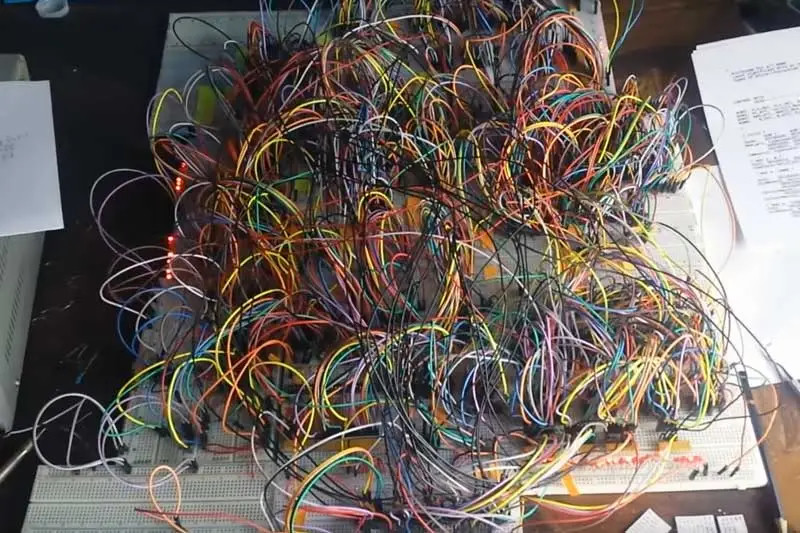
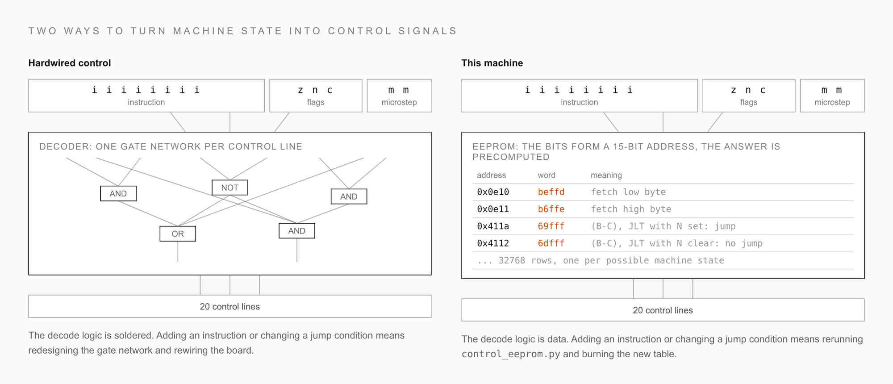

# Microcode and EEPROMs

Time to answer the question the last three chapters kept deferring. The machine has about twenty control lines: load this register, enable that one, count the program counter, write RAM, and so on. Executing an instruction means raising exactly the right lines in exactly the right order. Something has to look at the instruction and decide. What?

The textbook answer is decode logic: a network of gates that computes each control line from the instruction bits. Draw the truth table, minimize it, wire the gates. Every real CPU of the 7400 era had a control section like this, and it works. I was never going to build it, and to explain why, I owe you the full story of what building with 7400 parts is actually up against.

## The catch

Everything about 7400 parts pushes one way: optimize for hardware simplicity, as few components and as few wires as the design can get away with. Three constraints drive that:

1. Wiring. The simulators leave out the hard part. On a bench, every signal is a physical wire with two ends that must be the right ends, and a CPU is hundreds of hand-placed jumpers, any one of which can be subtly wrong. The failure mode is the worst kind: no smoke, just a computer that almost works. So the design keeps pushing complexity out of the wires and into places you program instead.

2. Shipping. There is no Amazon Prime for esoteric aerospace chips. Parts like the 74181 (4-bit ALU slice), designed in the 1970s and obsolete outside narrow legacy uses, come from specialty suppliers. Normal shipping to Calgary is expensive, express is prohibitive, and either way the envelope takes weeks. Iterating hardware across shipping cycles was never going to work, so the design had to survive on one order: get the parts list right and choose boring parts that hold no surprises.

3. Price. A modern microcontroller costs a dollar or two because billions are made. The obsolete 7400 parts, especially odd ones like the 74181 (4-bit ALU slice) and 74682 (8-bit comparator), come from small legacy runs and new-old-stock feeding repair shops and aerospace niches, so a 50-year-old chip holding a few hundred gates costs several times what a complete computer-on-a-chip does. The museum piece costs more than the supercomputer. I was in high school, paying for parts with odd programming jobs, and every socket had a price I felt.

Now hold the decode network up against those three constraints. It is the least regular, most error-prone wiring in the whole machine, hundreds of connections with no repeating structure. It is made of exactly the chips that take weeks to arrive and cost the most per gate. And every change to the instruction set means re-soldering some of it, which on a one-order parts budget is not a revision, it is a gamble. I wanted no part of that. So this machine's control unit contains no logic at all. It is a lookup table.

## The EEPROM as a custom chip

Here is the reframe that unlocked the whole design for me. An EEPROM is sold as a memory chip, but squint and it is something better: a chip whose behavior you define. It has 15 address pins and 8 data pins, and for every one of the 2^15 input combinations, it outputs whatever byte you told it to. That is a truth table with 32768 rows, programmed in seconds, socketed onto a board with zero design effort. It is the closest a breadboard builder gets to fabricating a custom chip. Any function of 15 bits, no gates, no wiring, one part.

So: make the inputs of the truth table "the machine's current situation" and the outputs "the control lines", and the control unit is done.

## The table

`eeprom/control_eeprom.py` generates the table. Its 15 address bits are the machine's entire visible state: eight bits of instruction (the low instruction byte, which holds the format bit and the fields), three ALU flags, a 2-bit microstep counter, and two unused bits. For each of the 32768 combinations, the script computes a 20-bit control word, one bit per line, active low. Burn the result into EEPROMs, wire instruction, flags, and step counter to the address pins, wire the data pins to the control lines, and the machine runs.

Every instruction takes three microsteps, and the reason is familiar by now: instructions are 16 bits and the bus is 8. Step one fetches the instruction's low byte into IRLow. Step two fetches the high byte into IRHigh. Step three executes, and a control line resets the step counter for the next fetch. Watch the three steps play out:

A click-through version of this animation is at [the explainers site](https://maxzabarka.github.io/homebrew-computer-explainers/#instruction-execution); the source is on [GitHub](https://github.com/MaxZabarka/homebrew-computer-explainers).

## The jump that costs nothing

Now the payoff I promised in chapter 4. Look again at what is on the address pins: the ALU flags. The current flags are part of the address being looked up, which means the table can give different answers for the same instruction depending on the flags. So the generator, at table-building time, asks for every combination: "this instruction wants to jump if less than; is the negative flag set in this row?" Where the answer is yes, the stored control word includes "load the program counter from A". Where it is no, the word leaves the program counter alone.

Read that again, because it is my favorite property of the machine: the branch decision is not made by the hardware at run time. It was made by a Python function, once, for every possible case, and burned into the chip. The function is `SHOULD_JUMP` in `constants.py`, and the emulator imports and calls the very same function, so the tables and the emulator cannot disagree about what a jump condition means.

This is why every compute instruction carries a jump field for free. No branch instruction, no extra cycle, no flag register. `(B-C), JLT` subtracts and branches in the same three microsteps as any other instruction.

## What it cost, and what it keeps paying

The costs are real and I accepted them with open eyes. The table stores 32768 answers where a few dozen gates could compute the same function; most rows are duplicates, since moves ignore the flags entirely. And an EEPROM lookup sits inside every microstep, so the chip's access time puts a ceiling on the clock. Slow and wasteful, exactly as predicted by chapter 3, and irrelevant to the goal, which was a machine that works.

What I did not fully appreciate at the time is the ongoing dividend: the instruction set became software. It lives in a Python file, in version control, next to the compiler. When I changed how a jump condition worked, I reran a script and got new chip contents, plus an emulator that agreed automatically. This one choice is most of the reason the project kept moving instead of dying in a rewiring session.

There is a second EEPROM doing the same trick for a different question, "which memory chip should answer this address?", and that question is the next chapter.

The full address layout, control word groups, and generator internals are in the [microcode reference](../reference/microcode-and-control-store.md).

Next: [The memory system](08-the-memory-system.md)
