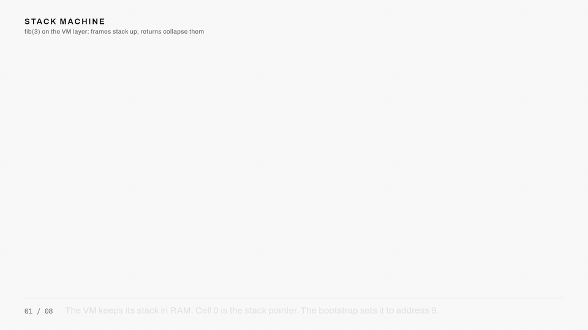

# Code generation and the VM

The parser hands us a tree. The machine wants byte pairs. You might expect the compiler to bridge that gap in one leap and emit assembly directly. Mine does something that looks like a detour: it emits code for a computer that does not exist, and then a second program translates that imaginary computer's code into real assembly. The detour is the best structural decision in the toolchain, and I want to walk you through why it exists before showing it working.

## Why compile to an imaginary machine

Think about what compiling an expression like `x + y * 2` directly to this machine would involve. The machine has two ALU operands, B and C, and one pointer, A, which is busy addressing memory. Real compilers solve this with register allocation, deciding which values live where and when to spill them to memory. Register allocation over effectively two registers is all spilling, all the time, and the compiler would be managing that dance while also walking the tree, tracking types, and laying out stack frames. Each concern is manageable. Together they are misery.

The escape is old and good, and I took it straight from nand2tetris: invent an intermediate machine that is pleasant to compile to, then translate its code mechanically. My imaginary machine is a stack machine. It has no registers at all, just a stack of bytes: operations pop their inputs off the top and push their result back. `push constant 2`, `push local 0`, `add`. Compiling a tree to stack code is almost embarrassingly natural, because a post-order walk of an expression tree is its stack code. Compile the left child, compile the right child, emit the operator. Done.

Watch a stack machine chew through an expression:

A click-through version of this animation is at [the explainers site](https://maxzabarka.github.io/homebrew-computer-explainers/#stack-machine); the source is on [GitHub](https://github.com/MaxZabarka/homebrew-computer-explainers).

The split buys simplicity on both sides. The compiler (`compiler/code_generator.py`) thinks only in pushes, pops, and operator names, and never once mentions a register. The translator (`virtual_machine/virtual_machine.py`) expands each stack operation into a fixed, always-correct sequence of moves, and never once thinks about expressions. I could debug each half by reading its text output, and I did, constantly.

## What the compiler emits

The code generator walks the AST with one symbol table per function, mapping each local and argument to a numbered stack slot (pointers take two slots, since addresses are 16 bits). The interesting mappings:

| C construct | VM code |
| --- | --- |
| `5` | `push constant 5` |
| `x` | `push local 0` |
| `x + y` | both pushes, then `add` |
| `x = expr` | expr, then `pop local 0` |
| `*p = expr` | expr, then p, then `poke` |
| `&x` | `push address-of-local 0` |
| `if` / `while` | conditions with `if-goto` and labels |
| `f(a, b)` | both pushes, then `call f 2` |

The whole of `tests/fib.c` becomes 25 lines of this. It reads like pseudocode, which is the point.

## The translator, and the price tag

The translator's job is dumb on purpose: for each VM operation, emit a fixed sequence of real instructions. `push constant 5` becomes: point A at the stack pointer, read it, point A at the stack top, write 5, increment the pointer, write it back. Every operation independently sets up A, does its work, and puts the world back. Nothing is cached between operations, no cleverness carries over, and that is precisely why every sequence is correct in any context.

The price tag is printed right on fib: 25 lines of VM code become 545 lines of assembly. A factor of twenty, from the same rhythm repeated: two loads, one pointer, everything through A, for every single operation. When people ask why the generated code is so long, the answer is chapter 5 plus a translator that refuses to be clever. I bought correctness with repetition, and on a machine running at emulated megahertz, repetition is cheap.

The full command set, the pointer bytes at RAM 0 through 5, and the segment mechanics are in the [VM layer reference](../reference/vm-layer.md).

## Where this leaves us

Here is the state of the world: any supported C program can now be lowered, mechanically, to hundreds of register moves that a table-driven CPU can execute. What I have not shown you is how the interesting things are built out of this plumbing. How does a machine with no multiply instruction multiply? How does `<` produce a value when flags evaporate? How does a 16-bit pointer get incremented by an 8-bit ALU, and how does recursion work when the hardware has no stack? Those algorithms are the payoff for all the constraints so far, and they get the next chapter to themselves.

Next: [Multiplication, recursion, and other missing instructions](11-multiplication-recursion-and-other-missing-instructions.md)
