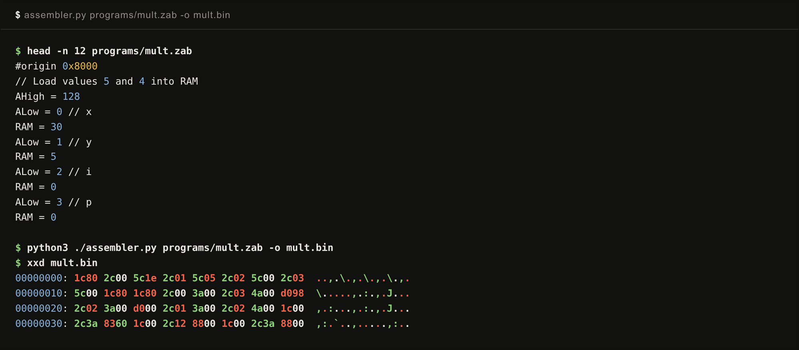
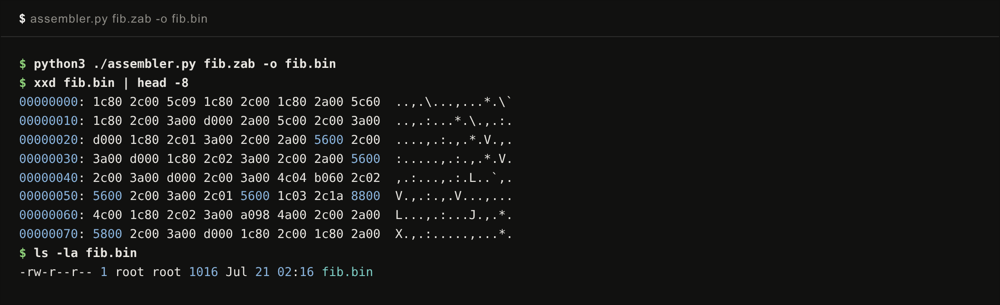

# The assembler

The last translator in the chain has the humblest job: turn `.zab` assembly text into the actual byte pairs the machine fetches. `assembler.py` is about 300 lines of Python, and this chapter is short because the assembler is simple, with exactly two ideas worth savoring.

## The language it assembles

Everything you have seen in earlier chapters, in one table:

| Form | Example | Meaning |
| --- | --- | --- |
| move constant | `AHigh = 128` | load an 8-bit immediate |
| move register | `B = RAM` | one register talks, one listens |
| symbol byte | `ALow = loop.l` | low or high byte of a label's address |
| compute | `RAM = (B+C)` | ALU expression into a destination |
| compute and jump | `(B-C), JEQ` | evaluate, jump to the address in A if equal |
| plain jump | `JMP` | unconditional jump to the address in A |
| label | `loop:` | name the current address |
| data | `0x55` | emit a literal byte |
| origin | `#origin 0x8000` | change the base added to labels |

No macros, no addressing modes, no expressions beyond the ALU menu. The `.l` and `.h` suffixes exist because of chapter 5: addresses cross the bus one byte at a time, so the language needs a way to name each half of a label.

## Idea one: assemble everything twice

A label can be used before it is defined; any forward jump does this. When the assembler meets `AHigh = end.h` on line 10 and `end:` lives on line 400, it cannot emit line 10 yet. The textbook fix is a symbol table plus a list of unresolved references to patch later. My fix is blunter, and I quote the source comment verbatim: "assemble everything twice to build symbol table lol".

Pass one assembles the whole program while emitting nothing, just counting bytes and recording where every label lands. Pass two assembles the identical program again, and now every symbol is known. Twice the work, zero patch-up logic, and on programs this size the second pass costs nothing measurable. It is the same trade the whole project makes, simplicity purchased with cycles.

## Idea two: one file, two address spaces

Here is the subtle one. Remember the Harvard split: code executes from ROM at address 0, data lives in RAM at 0x8000. The translator's output is one file that needs both worlds at once. A jump target like `loop:` must resolve to a ROM address, because that is where the program counter goes. But the stack arithmetic around it computes RAM addresses.

The `#origin` directive is the hinge. It does something deliberately strange: it never moves the output cursor. Bytes always come out sequentially. All `#origin` changes is the number added to label definitions. So the translator brackets its code labels with `#origin 0`, making them resolve as ROM addresses, and switches to `#origin 32768` where symbols should live in RAM space. One output stream, two coordinate systems, toggled with a directive. Six VM symbols (the stack pointer and friends from chapter 10) come predefined so the fixed RAM bytes always resolve.

## Seeing it work

`programs/mult.zab` is a hand-written multiply-by-repeated-addition, twenty-odd lines using every construct in the table. Assembling and dumping it:

Sixty-four bytes, each instruction low byte first. And the full fib pipeline's last stage, with the bootstrap's `1c80` (`AHigh = 128`) as the first word of the file:

The binary is now just bytes, no symbols, no text, nothing left to translate. The remaining question of this writeup is where those bytes go to become a running machine, and there are two answers: an emulator built for testing, and one built for watching.

Next: [The emulator core](13-the-emulator-core.md)
