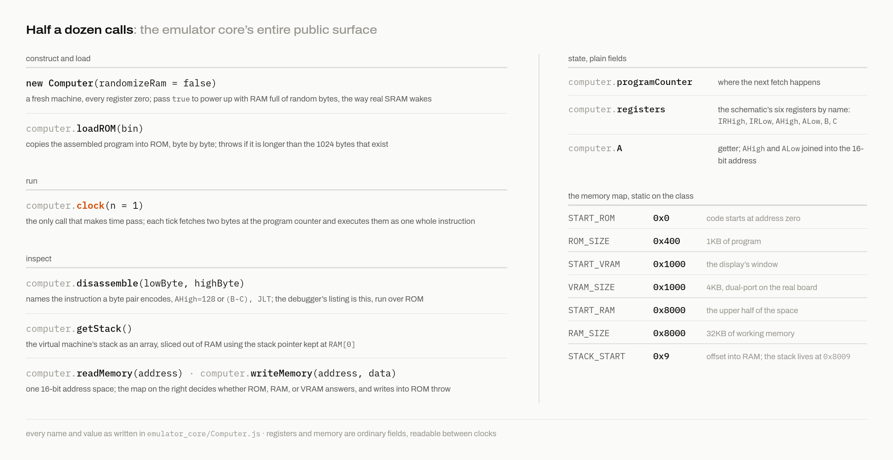

# The emulator core

The Logisim design can run binaries, but a circuit simulator is a place to verify wiring, and a miserable place to debug a compiler. While building the toolchain I needed to run programs thousands of times, fast, from scripts and tests. So the machine exists a second time as software: `emulator_core/`, a headless JavaScript model, and it became the workhorse of the entire project. The React debugger in the next chapter is a shell around this same core, so there is exactly one implementation of the machine's behavior.

## The interface

The core is one class, `Computer`, and its surface is small enough to show whole:



Load a binary with `loadROM`, call `clock()` once per instruction, and inspect state whenever you like: the registers sit as plain properties, `getStack()` reads the VM's stack region, and `disassemble` turns byte pairs back into assembly text for display. Running a compiled program headless is a five-line Node script:

```js
const Computer = require('./emulator_core/Computer');
const c = new Computer();
c.loadROM(require('fs').readFileSync('out.bin'));
c.clock(200000);
console.log(c.getStack());
```

## What it models, and how honestly

Each `clock()` performs one full instruction: fetch two bytes at the program counter, look at the format bit, and either resolve a move (who talks, who listens) or run a computation. Notice what that skips: the core does not simulate the three microsteps, the control store lookups, or the bus timing. Register moves are plain JavaScript assignments. I modeled at the instruction level because that is the level the toolchain cares about, and it is what makes the core fast enough to clock millions of instructions per second.

Except in one place, where I refused to abstract. The ALU in the core is the actual 74181 (4-bit ALU slice), gate for gate. `ALUCircuit.js` contains the chip's boolean equations exported from my Logisim model of it, instantiated twice with the low slice's carry-out patched into the high slice, exactly as the wires do it. Why be exact here and approximate everywhere else? Because register moves have no edge cases, and arithmetic is nothing except edge cases: the active-low carry, borrow conventions on subtraction, which flag a weird select pattern raises. Any hand-written "close enough" ALU would eventually disagree with the hardware in some corner, and I would have spent a week chasing a compiler bug that was actually an emulator bug. With the real equations in place, when a program misbehaves, the ALU is above suspicion.

Flags in the core live only inside a single `clock()` call, which is an accidental piece of fidelity: the hardware's flags are combinational and evaporate, and so do the core's.

## The core as test harness

This is why the headless half exists at all. `tests/test.js` drives it under Jest: for each of the 24 C programs, compile from source, load a fresh `Computer`, clock it 200000 times, and assert on the final stack:

```js
test("recursive multiplication", () => {
  testStack("recursive_mult.c", [30]);
});
```

The suite is the compiler's specification. If a construct appears in `tests/`, it works, and the expected stack says exactly what it does. And there is a mode I am fonder of than the tests themselves: a `RANDOMIZE` flag at the top switches the core to random initial RAM instead of zeros. Remember `fast_mult.c` from chapter 11, with its deliberately uninitialized `sum`? This flag exists to hunt exactly that class of sin. Any program that silently leans on zeroed memory gets caught the moment its luck runs out, on demand.

The memory model enforces the chapter 8 map with the same loud-failure philosophy: writes to ROM throw, access to unmapped holes throws. During compiler development, most of my bugs announced themselves as one of these two exceptions instead of as silent corruption three thousand cycles later.

The core runs binaries and settles arguments. But it is still invisible, a class you talk to through console logs. The other emulator is the one with a face, and it is the tool I actually stare at when something confusing happens.

Next: [The debugger](14-the-debugger.md)
