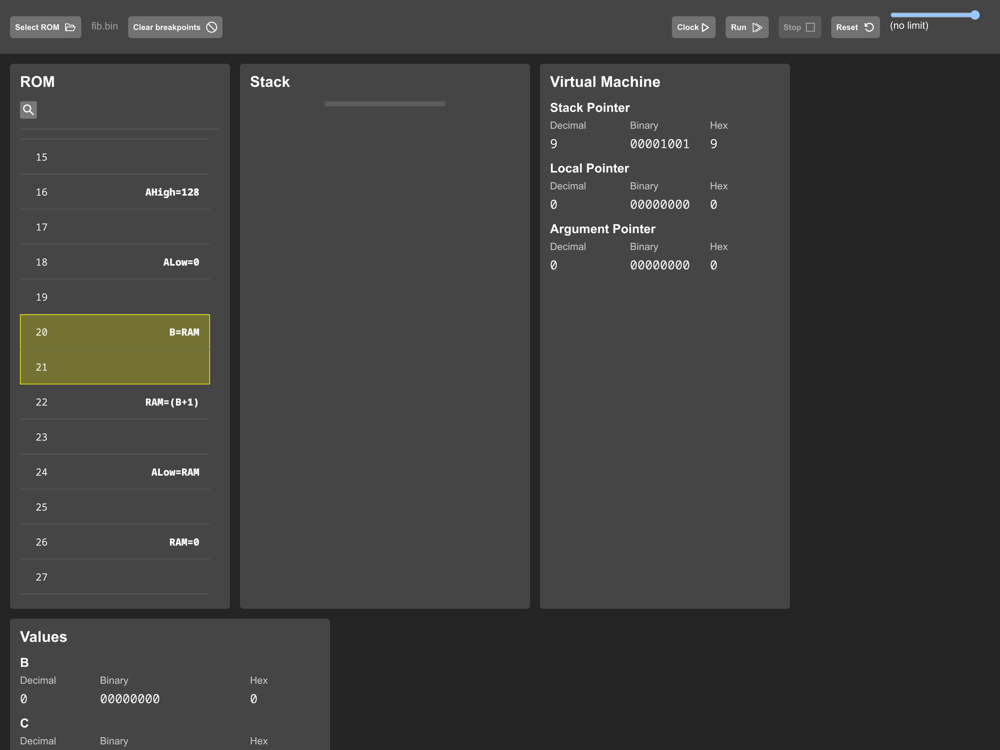

# The debugger

Watching this machine run is the payoff for everything else in this writeup, and the React app in `emulator/` is built for exactly that. It wraps the core from the last chapter in panels that show every piece of state we have discussed: the ROM disassembled, the stack, the VM's pointer bytes, and the registers, including the split A and the byte it points at. This chapter is a tour with screenshots, in the order you would actually use the thing.

## Pick a ROM

The toolbar is the whole control surface. Select ROM opens a file picker for any `.bin` the toolchain produced, and the loaded name sits next to the button:

Load `fib.bin` and the ROM panel fills with the disassembly, current instruction highlighted at address 0, the bootstrap we have met twice already: `AHigh=128`, `ALow=0`, `RAM=9`, the stack pointer being born.

## Step it

The Clock button executes exactly one instruction. This is the mode where the machine teaches. Click, and the highlight walks down two ROM rows (instructions are two bytes, so every instruction owns two rows). Click through the bootstrap and you can watch each chapter of this writeup happen in miniature: two clicks load the split A register, another writes 9 through it into RAM, and the Virtual Machine panel's stack pointer flips from 0 to 9 the instant the write lands:

Ten clicks in, the picture is this, with A parked at 0x8000 territory and the first frame being prepared:

## Set the speed

The slider on the right runs the clock automatically, and the readout below it reports two numbers: instructions per second, and the equivalent hardware clock. Here it is throttled to ten instructions per second:

That second line, 30.08Hz, is a detail I like: each instruction takes three microsteps in hardware (chapter 7), so the app multiplies by three to report what the physical clock would be doing. Ten instructions per second of emulation is thirty hertz of imaginary crystal. At this speed, a compiled program's execution is fully legible; you can watch fib recurse, frames stacking and unwinding:

## Uncap it

Drag the slider to the end and the readout switches to "(no limit)". The worker then clocks the core as fast as it can and reports the measured rate:

Around eleven megahertz of equivalent hardware clock, or roughly 3.7 million instructions per second, from gate-level ALU equations in JavaScript. For scale: the design's EEPROM access times cap the hardware clock far below that, so the emulator comfortably outruns the machine it models, which is exactly what you want from a development loop.

The interface stays responsive at full speed because the machine runs in a Web Worker on a separate thread, with a `SharedArrayBuffer` carrying the stop flag and the throttle between the UI and the worker.

## Break where it matters

Click any even ROM row and it arms as a breakpoint. The worker checks after every instruction and halts when the program counter lands there. Combined with the stack view, this answers the questions that actually come up: what is on the stack when we enter `fib`? What did `return` leave behind?

And that closes the loop the whole project set out to draw. C in at the top, and here at the bottom, a register view where you can watch `AHigh = 128` execute one click at a time. Every step between those two points is a thing this writeup has now walked through. What remains is one last chapter for the corners: the decisions and accidents that make this machine unmistakably itself.

Next: [Architectural quirks](15-architectural-quirks.md)
